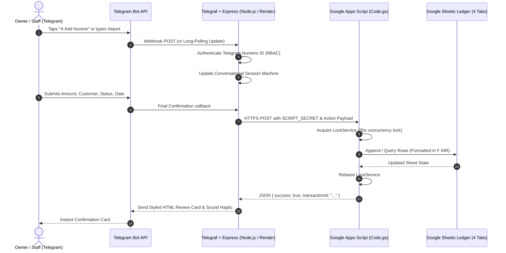

# 🌳 Rubber Business Telegram Income & Expense Tracker Bot

[](https://nodejs.org/)
[](https://telegraf.js.org/)
[](https://www.google.com/sheets/about/)
[](https://expressjs.com/)
[](https://render.com/)
[](file:///c:/Users/hanan/OneDrive/ドキュメント/rubber%20bot/test/bot.test.js)
[](https://opensource.org/licenses/MIT)

A complete, production-grade Telegram accounting and operational cashflow tracker designed specifically for **rubber business owners, estate managers, latex/sheet dealers, and authorized field staff**.

Built with **Node.js**, **Telegraf**, **Express**, and **Google Sheets** (via a zero-cost Google Apps Script Web App database backend). Includes a high-impact **Executive Web Dashboard (Telegram Mini App)** powered by **Chart.js**, **24/7 Persistent Docked Bottom Keyboards**, **Customer Dues & Parcel Balances Tracking**, **Staff Daily Wages**, **Goods Trade Margin Auditing**, and **One-Tap Excel Export with Built-in AI CFO Prompts**.

---

## 📑 Table of Contents

1. [🌟 Key Features & Capabilities](#-key-features--capabilities)
2. [🏗️ Architecture & Data Flow](#️-architecture--data-flow)
3. [📁 Folder & Project Structure](#-folder--project-structure)
4. [📊 Google Sheets Ledger Schema](#-google-sheets-ledger-schema)
5. [⌨️ Command Reference & Keyboard Layout](#️-command-reference--keyboard-layout)
6. [📱 Setup Guide 1: 100% Android Mobile Setup (No PC Required)](#-setup-guide-1-100-android-mobile-setup-no-pc-required)
7. [💻 Setup Guide 2: Local Development (PC / Mac / Linux)](#-setup-guide-2-local-development-pc--mac--linux)
8. [☁️ Setup Guide 3: Render Cloud Deployment (24/7 Free Hosting)](#️-setup-guide-3-render-cloud-deployment-247-free-hosting)
9. [📈 Modern Web Dashboard & Telegram Mini App](#-modern-web-dashboard--telegram-mini-app)
10. [🤖 One-Tap Excel Export & AI Financial Prompts](#-one-tap-excel-export--ai-financial-prompts)
11. [⚙️ Environment Variables Reference](#️-environment-variables-reference)
12. [🔒 Security, Roles & Concurrency Safeguards](#-security-roles--concurrency-safeguards)
13. [🧪 Testing & Verification Matrix](#-testing--verification-matrix)
14. [💡 Free Tier Limits & Resource Allocation](#-free-tier-limits--resource-allocation)
15. [🛠️ Troubleshooting & Diagnostic Guide](#️-troubleshooting--diagnostic-guide)
16. [📜 License](#-license)

---

## 🌟 Key Features & Capabilities

### 👑 1. Executive Dashboard (Telegram & Web)
* **In-Telegram Visual Dashboard (`/dashboard`):**
  * Formatted box-drawn executive cards with color-coded surplus/deficit badges (`🟢 SURPLUS` / `🔴 DEFICIT`).
  * Real-time ASCII/Emoji inflow-outflow balance bar:
    ```text
    [🟩🟩🟩🟩🟩🟩🟩🟥🟥🟥] 70% Inflow
    ```
  * Quick timeframe toggles: `⚡ Today`, `🗓️ Last 7 Days`, `📅 This Month`, and `🌐 All-Time`.
  * One-tap deep dive buttons into Goods Trade Margins and Staff Wage Ledgers.
* **Modern Responsive Web Dashboard (`/dashboard` & `/webapp`):**
  * Glassmorphism dark-mode UI designed with **Plus Jakarta Sans** and **JetBrains Mono**.
  * Interactive **Chart.js** visualizations:
    * **Daily Cashflow Trend:** Grouped Bar Chart comparing daily Income vs Expenses.
    * **Cost Distribution:** Interactive Doughnut Chart showing operational expense breakdown (Goods Purchases, Staff Wages, Travel, Refreshments, Utilities, Maintenance).
  * Real-time KPI Cards: Total Revenue, Total Expenses, Net Cashflow (with dynamic green/red glow), Goods Net Margin, Staff Wages Paid, and Travel Costs.
  * Live Ledger Table with instant client-side search, type filter chips (`All`, `Income`, `Expenses`, `Wages`), and sorting.
  * Native **Telegram Mini App (WebApp)** integration with haptic feedback and viewport auto-expansion.
  * Live Google Sheets sync with resilient fallback to sample preview data if disconnected.

---

### ⌨️ 2. 24/7 Persistent Docked Bottom Keyboard (`ReplyKeyboardMarkup`)
* Permanently docked right below the message input box on Telegram Mobile (Android/iOS) and Telegram Desktop.
* Eliminates the need to type `/start` or scroll back up through chat history.
* **Balanced 5-Row Layout:**
  * **Row 1 (Primary Actions):** `➕ Add Income` | `➖ Add Expense`
  * **Row 2 (Operations):** `👷 Staff Wages` | `🚗 Travel Expenses` | `📦 Goods Summary`
  * **Row 3 (Reports & History):** `📊 Daily Report` | `📅 Monthly Report` | `📄 Recent Records`
  * **Row 4 (Hubs & Clients):** `📥 Excel & AI Prompts` | `👑 Executive Hub` | `👥 Customers`
  * **Row 5 (Admin & Controls):** `👷 Employees` *(Owner only)* | `❓ Help` | `❌ Cancel / Reset`
* Instant-switch safety: tapping any bottom button immediately terminates and cleans up any in-progress wizard session.

---

### 💵 3. Categorized Income & Payment Status Tracking
* Dedicated categories for the rubber trade:
  * 🌳 **Rubber Sales** (RSS4, RSS5, Field Latex, Scrap/Cup lump)
  * 📦 **Goods Income** (Resale of chemicals, tapping cups, rain guards, estate supplies)
  * 👥 **Customer Payments** (Clearing previous credit balances)
  * 💰 **Other Income** (By-products, timber, inter-crop yield)
* **Three-Tier Payment Status Tracking:**
  * `✅ Fully Paid`: Total transaction amount received immediately.
  * `⏳ Not Paid (Parcel Due)`: Consignment delivered on credit; full amount marked as customer pending balance.
  * `📦 Partial / Parcel Paid`: Records amount received now, automatically calculates remaining unpaid balance, and tracks customer liability.
* Customer selection keyboard with auto-registration of new customer names to the Google Sheet.

---

### 📉 4. Categorized Operational Expenses
* **Goods & Business Purchases:** Rubber-related goods, raw materials, estate supplies, acid/chemicals.
* **Refreshments & Canteen:** Tea powder, sugar, coffee powder, worker canteen meals.
* **Utilities & Maintenance:** LED bulbs, electrical items, tapping knives sharpening, machinery & estate maintenance.
* **Miscellaneous:** Taxes, transport levies, and one-off operational costs.

---

### 👷 5. Staff Daily Wages Management
* Clickable worker selector built directly from active records in the `Employees` sheet.
* Flexible daily wage entry in Indian Rupees (`₹`) — supports real estate daily rates without forced fixed salaries.
* Work notes (tapping, weeding, scrap collection, processing, night watch).
* Wage audit history: inspect total wages paid per employee for any timeframe.

---

### 🚗 6. Travel & Logistics Expenses
* Records field staff travel, logistics, and supply pickup trips.
* Captures driver/worker name, travel route (e.g. `Estate ➔ Kottayam Market`), travel purpose, and ₹ amount.

---

### 📦 7. Goods Trade Margin & Merchandise Hub
* Compares **Goods Income** vs **Goods Purchases** in real-time.
* Calculates **Goods Trading Difference** (`Goods Income − Goods Purchases`) and gross margin percentage to prevent inventory cost leakages.

---

### 👥 8. Customer Directory & Outstanding Dues (`/dues`)
* Centralized directory of registered rubber buyers and dealers.
* **Outstanding Dues & Balances Hub (`/dues`):**
  * Scans all historical transactions for `Not Paid` and `Partial Paid` status.
  * Aggregates total pending receivables across your entire business.
  * Provides a customer-by-customer breakdown of unpaid consignments.
* Admin controls to add new customers and toggle Active/Inactive status.

---

### 🗑️ 9. Transaction Deletion & Modification Safeguards (`/delete`)
* Mistake correction without leaving Telegram.
* Two deletion modes:
  1. Pick from the latest 10 recorded transactions via an interactive inline list.
  2. Direct deletion via command: `/delete TXN-INC-20261019-XXXX`.
* Shows a detailed confirmation card (ID, Type, Amount, Category, Party, Date) before deleting.
* Safely removes the row from the Google Sheets ledger.

---

### 📊 10. Financial Reports (IST Timezone)
* **Daily Report (`/report`):** Today's income, expenses, net cashflow, wages, travel, goods margin, and entry count.
* **Monthly Report:** Full calendar month financial rollup.
* **Custom Date Range Report:** Select any custom start and end date (`YYYY-MM-DD`).
* Clear mathematical definitions:
  $$\text{Net Cashflow} = \text{Total Income} - \text{Total Expenses}$$
  $$\text{Goods Margin} = \text{Goods Income} - \text{Goods Purchases}$$

---

### 📥 11. One-Tap Excel Export & Built-in AI CFO Prompts (`/ai`, `/excel`)
* Generates and sends a formatted multi-tab `.xlsx` Excel workbook directly into your Telegram chat.
* Includes all ledger data: `Transactions`, `Employees`, `Customers`, and `Categories`.
* Provides 5 pre-engineered AI prompt templates optimized for **ChatGPT, Claude, and Gemini**:
  1. 📊 Full Business Health & Net Profit Audit (CFO role)
  2. 👥 Customer & Rubber Sales Concentration Analysis
  3. 👷 Staff Daily Wages & Labor Cost Variance
  4. 📦 Goods Merchandise & Trading Gross Margins
  5. ✂️ Expense Optimization & Cost Leakage Detection
* One-tap button to open the live Google Spreadsheet in your mobile or desktop browser.

---

## 🏗️ Architecture & Data Flow



### High-Level Topology

```text
┌────────────────────────────────────────────────────────┐
│                   TELEGRAM CLIENT                      │
│        (Mobile Android / iOS / Desktop / Web)          │
└──────────────────────────┬─────────────────────────────┘
                           │ HTTPS (TLS 1.3)
                           ▼
┌────────────────────────────────────────────────────────┐
│         NODE.JS BACKEND (RENDER / LOCALHOST)           │
│  ┌───────────────────────┬───────────────────────────┐ │
│  │   Telegraf Bot Core   │   Express Web Server      │ │
│  │   - Auth Middleware   │   - Telegram Webhook /    │ │
│  │   - Session Manager   │     Long Polling fallback │ │
│  │   - Keyboard Builders │   - WebApp Dashboard HTML │ │
│  │   - 11 Domain Handlers│   - REST API /api/stats   │ │
│  └───────────────────────┴───────────────────────────┘ │
└──────────────────────────┬─────────────────────────────┘
                           │ HTTPS POST (JSON + SCRIPT_SECRET)
                           ▼
┌────────────────────────────────────────────────────────┐
│            GOOGLE APPS SCRIPT WEB APP                  │
│  ┌───────────────────────────────────────────────────┐ │
│  │  Code.gs (doPost / doGet)                         │ │
│  │  - LockService (Concurrency Lock)                 │ │
│  │  - Action Router (Transactions, Employees, etc.)  │ │
│  │  - SpreadsheetApp SDK Engine                      │ │
│  └───────────────────────────────────────────────────┘ │
└──────────────────────────┬─────────────────────────────┘
                           │ Internal Google Cloud Bus
                           ▼
┌────────────────────────────────────────────────────────┐
│           GOOGLE SHEETS PERMANENT DATABASE             │
│  ├── Transactions (Ledger with Payment Status & Dues)  │
│  ├── Employees    (Active Staff Roster)                │
│  ├── Customers    (Buyer Directory & Dues Registry)    │
│  └── Categories   (Income & Expense Business Taxonomy) │
└────────────────────────────────────────────────────────┘
```

---

## 📁 Folder & Project Structure

```text
rubber-bot/
├── .env.example                     # Template for environment variables
├── .gitignore                       # Ignored files (node_modules, .env, scratch)
├── package.json                     # NPM dependencies, scripts, engines
├── package-lock.json                # Locked dependency tree
├── render.yaml                      # Render Infrastructure-as-Code Blueprint
├── README.md                        # Master documentation and manuals
│
├── google-apps-script/
│   └── Code.gs                      # Google Apps Script Web App database backend (1250 lines)
│
├── src/
│   ├── index.js                     # Server entry point, Telegraf bot & Express setup
│   │
│   ├── config/
│   │   └── config.js                # Environment config, category taxonomies & defaults
│   │
│   ├── middleware/
│   │   └── auth.js                  # Numeric Telegram ID authorization (RBAC)
│   │
│   ├── services/
│   │   ├── sheetsService.js         # HTTP client & Excel workbook generator (xlsx)
│   │   ├── sessionStore.js          # In-memory conversational state machine
│   │   └── dashboardService.js      # Aggregates KPIs, charts, and ledger records
│   │
│   ├── keyboards/
│   │   ├── replyKeyboards.js        # 24/7 Persistent Docked Bottom Keyboards
│   │   └── inlineKeyboards.js       # Dynamic in-chat inline buttons and wizards
│   │
│   ├── handlers/
│   │   ├── menuHandler.js           # /start, persistent menu & help cards
│   │   ├── dashboardHandler.js      # Telegram in-chat executive dashboard
│   │   ├── incomeHandler.js         # Multi-step Income recording wizard
│   │   ├── expenseHandler.js        # Multi-step Expense recording wizard
│   │   ├── wagesHandler.js          # Staff daily wages recording wizard
│   │   ├── travelHandler.js         # Travel & logistics recording wizard
│   │   ├── goodsHandler.js          # Goods trade margin & summary cards
│   │   ├── reportHandler.js         # Daily, Monthly & Custom Date range reports
│   │   ├── customerHandler.js       # Customer directory, add customer & /dues audit
│   │   ├── employeeHandler.js       # Staff management & cumulative wages audit
│   │   ├── recentHandler.js         # Recent transaction feed & /delete workflow
│   │   └── aiAnalysisHandler.js     # Excel download & 5 pre-built AI CFO prompts
│   │
│   ├── routes/
│   │   └── dashboardRoutes.js       # Express HTTP routes for WebApp and REST API
│   │
│   ├── web/
│   │   └── dashboardHtml.js         # Glassmorphism dark-mode Web Dashboard (Chart.js)
│   │
│   └── utils/
│       ├── formatter.js             # Currency (₹ INR), IST date/time & HTML escaping
│       ├── idGenerator.js           # Cryptographic collision-resistant TXN ID generator
│       └── logger.js                # Timestamped structured logger with IST offset
│
└── test/
    └── bot.test.js                  # 34 automated unit & integration test suites
```

---

## 📊 Google Sheets Ledger Schema

When initialized via `setupSheets()` in Google Apps Script, the workbook automatically creates and styles 4 structured sheets:

### 1. `Transactions` Sheet (Forest Green Header `#1B5E20`)
| Col | Header Name | Format | Example | Notes |
|:---:|---|:---:|---|---|
| **A** | `Transaction ID` | Text | `TXN-INC-20261019-9B21` | Unique primary key |
| **B** | `Timestamp` | Text | `2026-10-19 18:30:15` | Recorded timestamp (IST) |
| **C** | `Transaction Date` | Date | `2026-10-19` | Effective date (`YYYY-MM-DD`) |
| **D** | `Transaction Type` | Text | `Income` / `Expense` | High-level ledger type |
| **E** | `Category` | Text | `Rubber Sales` | Specific category |
| **F** | `Amount` | `₹#,##0.00` | `₹45,000.00` | Total transaction value |
| **G** | `Income Source or Expense Purpose` | Text | `Kottayam Rubber Traders` | Customer or vendor name |
| **H** | `Employee Name` | Text | `Raju` | Populated for Wages & Travel |
| **I** | `Travel Details` | Text | `Estate -> Kottayam (Acid)` | Origin, Destination, Purpose |
| **J** | `Description` | Text | `120 kg RSS4 Grade @ ₹375` | User-entered notes |
| **K** | `Entered By` | Text | `Hanan (Owner)` | Telegram user's first name |
| **L** | `Telegram User ID` | Text | `123456789` | Numeric Telegram user ID |
| **M** | `Payment Status` | Text | `Partial Paid` / `Paid` / `Not Paid`| Tracks settlement state |
| **N** | `Paid Amount` | `₹#,##0.00` | `₹30,000.00` | Amount settled in cash/UPI |
| **O** | `Balance Due` | `₹#,##0.00` | `₹15,000.00` | Outstanding customer liability |

### 2. `Employees` Sheet (Deep Blue Header `#0D47A1`)
| Col | Header Name | Format | Example |
|:---:|---|:---:|---|
| **A** | `Employee ID` | Text | `EMP-001` |
| **B** | `Employee Name` | Text | `Raju` |
| **C** | `Active Status` | Text | `Active` / `Inactive` |

### 3. `Customers` Sheet (Deep Purple Header `#4A148C`)
| Col | Header Name | Format | Example |
|:---:|---|:---:|---|
| **A** | `Customer ID` | Text | `CUST-001` |
| **B** | `Customer Name` | Text | `Kottayam Rubber Traders` |
| **C** | `Active Status` | Text | `Active` / `Inactive` |

### 4. `Categories` Sheet (Slate Header `#37474F`)
Pre-seeded with rubber trade classifications:
* **Income:** Rubber Sales, Goods Income, Customer Payments, Other Income.
* **Goods & Business Purchases:** Rubber-related goods purchases, Raw materials, Supplies, Other goods purchases.
* **Staff Wages:** Staff wages.
* **Travel Expenses:** Travel expenses.
* **Other Expenses:** Tea powder, Sugar, Coffee powder, Food and refreshments, LED bulbs and electrical items, Cleaning supplies, Maintenance, Other miscellaneous expenses.

---

## ⌨️ Command Reference & Keyboard Layout

### 💬 Telegram Slash Commands

| Command | Aliases | Access Level | Description |
|---|---|:---:|---|
| `/start` | `/menu` | All Users | Initializes bot, sends persistent keyboard, and displays Main Menu |
| `/dashboard` | `/dash`, `/stats` | All Users | Displays in-chat visual KPI dashboard with period switches & WebApp button |
| `/income` | — | All Users | Launches the Add Income step-by-step recording wizard |
| `/expense` | — | All Users | Displays categorized Expense selection menu |
| `/wages` | — | All Users | Launches Staff Daily Wages recording wizard |
| `/travel` | — | All Users | Launches Travel & Logistics expense wizard |
| `/report` | — | All Users | Generates Today's Financial Report with Net Cashflow & Cost breakdown |
| `/goods` | — | All Users | Displays Goods Income vs Purchases and Net Margin for the month |
| `/recent` | `/records` | All Users | Displays the last 10 recorded transactions with details |
| `/dues` | `/balances`, `/pending` | All Users | Scans all transactions and lists customers with pending/unpaid parcel dues |
| `/delete` | `/remove` | All Users | Initiates transaction deletion picker or deletes by ID: `/delete [TX_ID]` |
| `/ai` | `/sheet`, `/analysis` | All Users | Opens the AI Prompt Hub, direct Google Sheet link, and Excel export menu |
| `/excel` | `/download`, `/export`| All Users | Generates and sends a downloadable multi-tab `.xlsx` workbook |
| `/customers` | `/customer` | Owner Only | Opens Customer Directory, Add Customer, and Active/Inactive toggle menu |
| `/employees` | `/employee` | Owner Only | Opens Staff Management, Add Worker, and Wage Audit menu |
| `/help` | — | All Users | Detailed operational help card, command index, and support tips |

---

### 📱 Persistent Docked Bottom Keyboard Map

```text
┌─────────────────────────────────┬─────────────────────────────────┐
│          ➕ Add Income          │         ➖ Add Expense          │
├─────────────────┬───────────────┴─┬───────────────────────────────┤
│ 👷 Staff Wages  │🚗 Travel Expenses│        📦 Goods Summary       │
├─────────────────┼─────────────────┼───────────────────────────────┤
│ 📊 Daily Report │ 📅 Monthly Report│       📄 Recent Records       │
├─────────────────┼─────────────────┼───────────────────────────────┤
│📥 Excel & AI Prompts│👑 Executive Hub│          👥 Customers          │
├─────────────────┼─────────────────┼───────────────────────────────┤
│  👷 Employees   │     ❓ Help     │       ❌ Cancel / Reset       │
└─────────────────┴─────────────────┴───────────────────────────────┘
```
*(Row 5 displays `👷 Employees` for the business owner only; authorized staff see a clean 2-button control row: `❓ Help` and `❌ Cancel / Reset`)*.

---

## 📱 Setup Guide 1: 100% Android Mobile Setup (No PC Required)

You can complete this entire setup on an Android smartphone using **Google Chrome** and the **Telegram app**.

### Step 1: Create Your Telegram Bot
1. Open the **Telegram** app.
2. Search for `@BotFather` (verified checkmark) and tap **Start**.
3. Send `/newbot`.
4. Enter a display name (e.g. `Kerala Rubber Business Tracker`).
5. Enter a username ending in `bot` (e.g. `kerala_rubber_bot`).
6. BotFather will provide an **API Token** formatted like:
   ```text
   7123456789:ABCdefGHIjklMNOpqrsTUVwxyz
   ```
7. Copy and save this token in your notes.

---

### Step 2: Obtain Telegram Numeric User IDs
1. In Telegram, search for `@userinfobot` and tap **Start**.
2. Note your numeric **Id** (e.g. `987654321`). This is your **`OWNER_ID`**.
3. Have your trusted staff members message `@userinfobot` and send you their IDs. These become your comma-separated **`ALLOWED_STAFF_IDS`** (e.g. `112233445,998877665`).

---

### Step 3: Setup Google Sheet & Google Apps Script
1. Open **Google Chrome** on your phone and go to [https://sheets.new](https://sheets.new).
2. Rename the new spreadsheet to `Rubber Business Ledger`.
3. Tap the Chrome **three dots menu (⋮)** in the top right corner and check **Desktop site**.
4. In the top spreadsheet menu, tap **Extensions ➔ Apps Script**. A new tab opens with the Apps Script editor.
5. Erase any placeholder code inside `Code.gs`.
6. Open [`google-apps-script/Code.gs`](file:///c:/Users/hanan/OneDrive/ドキュメント/rubber%20bot/google-apps-script/Code.gs), copy the entire code, and paste it into the editor.
7. Tap the **Save (💾)** icon.
8. **Initialize Sheets:**
   * At the top of the editor, click the function dropdown (where it says `myFunction` or `setupSheets`).
   * Select **`setupSheets`** and tap **Run**.
   * When prompted for permissions: tap **Review permissions** ➔ Select your Google Account ➔ Tap **Advanced** ➔ Tap **Go to Untitled project (unsafe)** ➔ Tap **Allow**.
   * Switch back to your Google Sheet tab. You will see 4 beautifully formatted sheets: `Transactions`, `Employees`, `Customers`, and `Categories`.
9. **Deploy as Web App:**
   * In the Apps Script tab, tap **Deploy ➔ New deployment**.
   * Tap the **Gear icon (⚙️)** next to "Select type" and select **Web app**.
   * Configure:
     * **Description:** `Rubber Bot Backend`
     * **Execute as:** `Me (your_email@gmail.com)`
     * **Who has access:** `Anyone` *(Essential: allows your bot backend to reach the sheet using the secret key)*.
   * Tap **Deploy**.
   * Copy the generated **Web App URL** (ends in `/exec`).

---

### Step 4: Create GitHub Repository on Mobile
1. Open Chrome and go to [https://github.com](https://github.com).
2. Tap the **+** button in the top right ➔ **New repository**.
3. Name it `rubber-business-bot`, choose **Private** (or Public), and tap **Create repository**.
4. Upload the project files:
   * Tap **Add file ➔ Upload files**.
   * Select the repository files from your phone's file storage.
   * Tap **Commit changes**.

---

### Step 5: Deploy on Render from Mobile
1. Open [https://render.com](https://render.com) in Chrome and sign in with GitHub.
2. Tap **New + ➔ Web Service**.
3. Select your `rubber-business-bot` repository.
4. Settings:
   * **Name:** `rubber-bot`
   * **Region:** `Singapore` (optimal latency for India)
   * **Branch:** `main`
   * **Runtime:** `Node`
   * **Build Command:** `npm install`
   * **Start Command:** `npm start`
   * **Instance Type:** `Free`
5. Scroll down to **Environment Variables** and enter:
   * `BOT_TOKEN`: Your token from @BotFather
   * `OWNER_ID`: Your numeric Telegram ID from @userinfobot
   * `ALLOWED_STAFF_IDS`: Comma-separated staff IDs
   * `GOOGLE_SCRIPT_URL`: Your Apps Script Web App URL (`.../exec`)
   * `GOOGLE_SCRIPT_SECRET`: `my_secure_rubber_bot_secret_2026`
   * `GOOGLE_SHEET_URL`: The direct URL of your Google Sheet
6. Tap **Create Web Service**.
7. Within 2 minutes, Render will build and deploy the bot. Status will switch to **Live**.

---

## 💻 Setup Guide 2: Local Development (PC / Mac / Linux)

### Prerequisites
* **Node.js**: v18.0.0 or higher (`node -v`)
* **npm**: v9.0.0 or higher (`npm -v`)
* **Git**: Installed and configured

### 1. Clone & Install Dependencies
```bash
git clone https://github.com/your-username/rubber-business-bot.git
cd rubber-business-bot
npm install
```

### 2. Configure Environment Variables
Copy the template and configure your secrets:
```bash
cp .env.example .env
```
Open `.env` in your text editor and fill in your values:
```env
BOT_TOKEN=1234567890:ABCdefGHIjklMNOpqrsTUVwxyz
OWNER_ID=123456789
ALLOWED_STAFF_IDS=987654321,555444333
GOOGLE_SCRIPT_URL=https://script.google.com/macros/s/AKfycbx.../exec
GOOGLE_SCRIPT_SECRET=my_secure_rubber_bot_secret_2026
GOOGLE_SHEET_URL=https://docs.google.com/spreadsheets/d/your_sheet_id/edit
PORT=3000
WEBHOOK_DOMAIN=
```
*(Leave `WEBHOOK_DOMAIN` empty to let the bot automatically run in long-polling mode during local development)*.

### 3. Run the Automated Test Suite
Verify that all 34 tests pass before launching:
```bash
npm test
```

### 4. Start the Application
* **Development mode (with auto-restart on file save):**
  ```bash
  npm run dev
  ```
* **Production mode:**
  ```bash
  npm start
  ```

### 5. Accessing Local Endpoints
* **Web Dashboard:** Open [http://localhost:3000/dashboard](http://localhost:3000/dashboard) in your browser.
* **REST API:** Check [http://localhost:3000/api/dashboard/stats](http://localhost:3000/api/dashboard/stats).
* **Health Check:** [http://localhost:3000/health](http://localhost:3000/health) returns `{ status: "ok" }`.

---

## ☁️ Setup Guide 3: Render Cloud Deployment (24/7 Free Hosting)

This repository includes a ready-to-deploy [`render.yaml`](file:///c:/Users/hanan/OneDrive/ドキュメント/rubber%20bot/render.yaml) blueprint.

### Automatic Webhook Detection
When deployed on Render, the backend automatically detects the `RENDER_EXTERNAL_URL` environment variable provided by Render's infrastructure. It automatically registers the Telegram Webhook at:
```text
https://your-service-name.onrender.com/telegram-webhook
```
Zero manual webhook configuration or ngrok tunnels required.

### Render Blueprint Deployment Steps
1. Push your repository to GitHub.
2. Log into [Render Dashboard](https://dashboard.render.com).
3. Click **New + ➔ Blueprint**.
4. Connect your GitHub repository. Render reads `render.yaml` and auto-provisions the Web Service with Node 20.x.
5. In the prompted fields, paste your `BOT_TOKEN`, `OWNER_ID`, `ALLOWED_STAFF_IDS`, `GOOGLE_SCRIPT_URL`, and `GOOGLE_SCRIPT_SECRET`.
6. Click **Apply**.

---

## 📈 Modern Web Dashboard & Telegram Mini App

The bot includes an executive dashboard accessible via browser or as an embedded Telegram Mini App:

### How to Access
* In Telegram: Tap **`👑 Executive Hub`** ➔ **`🌐 Open Web Dashboard`**.
* In Any Browser: Visit `https://your-render-app.onrender.com/dashboard`.

### Key Capabilities
* **Dynamic Timeframe Selector:** Instantly toggle between `⚡ Today`, `🗓️ Last 7 Days`, `📅 This Month`, and `🌐 All-Time`.
* **Cashflow Trend Chart:** Grouped bar chart comparing daily revenue against daily operating expenses.
* **Cost Distribution Chart:** Doughnut chart detailing where money was spent across all 6 expense categories.
* **Instant Filter & Search:** Real-time client-side filter chips (`All`, `Income`, `Expenses`, `Wages`) and live search by category, customer, employee, or notes.
* **Haptic Feedback:** Native Telegram WebApp SDK haptics trigger on button taps when opened inside Telegram.

---

## 🤖 One-Tap Excel Export & AI Financial Prompts

The bot bridges the gap between daily Telegram entry and advanced financial intelligence:

### 📥 Instant Excel Workbook (`/excel`)
Run `/excel` or tap **`📥 Excel & AI Prompts` ➔ `📥 Download Excel File`**. The bot automatically creates and sends `Rubber_Business_Ledger.xlsx` with:
* Tab 1: `Transactions` (Complete ledger with formulas and formatting)
* Tab 2: `Employees` (Worker roster and status)
* Tab 3: `Customers` (Buyer directory)
* Tab 4: `Categories` (Taxonomy mapping)

### 🧠 Pre-Engineered AI CFO Prompts (`/ai`)
Attach the downloaded Excel file to **ChatGPT, Claude, or Gemini**, and copy-paste any of the 5 built-in prompt templates:

1. **📊 Full Business Health & Net Profit Audit:**
   * Acts as a CFO analyzing revenue streams, operating cost ratios, daily cashflow volatility, and net profit margins.
2. **👥 Customer & Rubber Sales Performance:**
   * Identifies top rubber buyers by volume and rupee value, evaluates customer concentration risk, and recommends sales retention strategies.
3. **👷 Staff Daily Wages & Labor Cost Analysis:**
   * Analyzes daily worker wage trends, labor cost as a percentage of total overhead, and variance across tapping and estate upkeep.
4. **📦 Goods Trade Margin & Merchandise Profitability:**
   * Audits Goods Sales vs Goods Purchases to calculate gross trade margin % and detect underpriced stock.
5. **✂️ Expense Optimization & Cost Leakage Detection:**
   * Audits travel routes, daily refreshment expenses, and utility outlays to provide 5 concrete cost-reduction steps.

---

## ⚙️ Environment Variables Reference

| Variable Name | Required | Default | Example Value | Purpose |
|---|:---:|:---:|---|---|
| `BOT_TOKEN` | **Yes** | — | `7123456789:ABC...` | Telegram bot token obtained from @BotFather |
| `OWNER_ID` | **Yes** | — | `123456789` | Numeric Telegram ID of business owner (Full Admin access) |
| `ALLOWED_STAFF_IDS` | No | `""` | `987654321,555444333` | Comma-separated numeric IDs of authorized estate workers |
| `GOOGLE_SCRIPT_URL` | **Yes** | — | `https://script.google.com/macros/s/.../exec` | Deployment Web App URL from Google Apps Script |
| `GOOGLE_SCRIPT_SECRET` | No | `my_secure_rubber_bot_secret_2026` | `your_secret_hash` | Shared secret to prevent unauthorized HTTP calls to Google Script |
| `GOOGLE_SHEET_URL` | No | Built-in link | `https://docs.google.com/spreadsheets/d/...` | Direct spreadsheet URL opened by the in-bot link button |
| `PORT` | No | `3000` | `3000` | HTTP port for Express server and dashboard |
| `WEBHOOK_DOMAIN` | No | Auto on Render | `https://rubber-bot.onrender.com` | Public HTTPS domain for Telegram Webhooks. If empty, uses Long Polling |

---

## 🔒 Security, Roles & Concurrency Safeguards

1. **Numeric ID Authentication (Zero Impersonation):**
   * Telegram usernames can be changed at any time and can be spoofed; this bot authenticates strictly against immutable 64-bit Telegram numeric user IDs.
   * Any unauthorized user sending a message is blocked with an informative `⛔ Access Denied` screen displaying their numeric ID for easy whitelisting.
2. **Role-Based Access Control (RBAC):**
   * **Owner (`OWNER_ID`):** Can record transactions, view all reports, manage employees, manage customers, inspect dues, download Excel workbooks, and delete transactions.
   * **Staff (`ALLOWED_STAFF_IDS`):** Can record income, expenses, wages, travel, and view daily reports. Cannot access employee rosters or customer admin controls.
3. **Google Apps Script Secret Verification:**
   * Every HTTP POST from Node.js sends the shared secret token in its payload. Google Apps Script rejects any request without a matching secret with HTTP 401 Unauthorized.
4. **ScriptLock Concurrency Protection:**
   * Google Apps Script wraps sheet writes inside `LockService.getScriptLock().tryLock(30000)`. If multiple workers submit transactions at the exact same second, requests queue safely without overwriting rows or corrupting formulas.
5. **DNS & Network Resilience:**
   * Built-in custom HTTPS agent uses `ipv4first` resolution and IPv4 fallback (`149.154.166.110`) to eliminate socket hang-ups caused by ISP DNS routing quirks.

---

## 🧪 Testing & Verification Matrix

The project features a comprehensive automated test suite built with Node.js's native test runner (`node:test`).

### Run Automated Tests
```bash
npm test
```

### Automated Test Coverage (34 Tests / 10 Suites)
* ✔ **Formatting & Validation Utilities:** Indian Rupee currency format (`₹#,##0.00`), IST date parser, `YYYY-MM-DD` validator.
* ✔ **ID Generator:** Cryptographic format check (`TXN-TYPE-YYYYMMDD-XXXX`), collision resistance.
* ✔ **Session Store:** TTL state expiry, conversational step management.
* ✔ **Report & Summary Calculations:** Mathematical correctness of Net Cashflow and Goods Difference.
* ✔ **Customer Management & Dues:** Keyboard builders, payload byte-size safety (<64 bytes callback limit), dues aggregation.
* ✔ **AI Analysis & Excel Engine:** XLSX workbook generation, buffer validation, AI prompt formatting.
* ✔ **Executive Dashboard:** Date range calculations, KPI summaries, Telegram visual card rendering, HTML dashboard generation.
* ✔ **Payment Status & Parcel Balances:** Fully Paid, Not Paid, and Partial Paid balance calculation.
* ✔ **Transaction Deletion:** Deletion flow, inline picker generation, confirmation callbacks.
* ✔ **Persistent Bottom Keyboards:** ReplyKeyboardMarkup layout, role-based button filtering.

---

### Manual QA Checklist for Deployment Verification
- [ ] Send `/start`. Confirm that the persistent bottom keyboard docks at the bottom of the screen.
- [ ] Have an unauthorized user send `/start`. Confirm that the bot replies with `⛔ Access Denied` and shows their numeric ID.
- [ ] Tap `➕ Add Income` ➔ `🌳 Rubber Sales` ➔ Enter `50000` ➔ Select customer ➔ Choose `📦 Partial Paid` ➔ Enter `35000` ➔ Select `📅 Today`. Confirm that the review card shows `Paid: ₹35,000.00` and `Due: ₹15,000.00`.
- [ ] Run `/dues`. Confirm that the customer's `₹15,000.00` pending parcel balance is listed.
- [ ] Tap `➖ Add Expense` ➔ `📦 Goods & Purchases` ➔ Enter `10000`. Confirm row appears in Google Sheets.
- [ ] Tap `📦 Goods Summary`. Confirm that Goods Difference displays `₹40,000.00` surplus.
- [ ] Tap `👷 Staff Wages` ➔ Pick an employee ➔ Enter `950`. Confirm entry is recorded.
- [ ] Tap `📊 Daily Report`. Verify that Total Income, Total Expenses, and Net Cashflow match recorded entries.
- [ ] Tap `📥 Excel & AI Prompts` ➔ `📥 Download Excel File`. Verify that the bot sends `Rubber_Business_Ledger.xlsx` and that the file opens cleanly in Excel / Sheets.
- [ ] Tap `👑 Executive Hub` ➔ `🌐 Open Web Dashboard`. Confirm that the interactive charts load and the ledger table displays recorded transactions.
- [ ] Tap `📄 Recent Records` ➔ `🗑️ Delete an Entry`. Pick the last test transaction and confirm deletion. Verify that the row is removed from Google Sheets.

---

## 💡 Free Tier Limits & Resource Allocation

### 1. Render Free Tier
* **Cost:** $0.00 / month (No credit card required).
* **RAM / CPU:** 512 MB RAM, 0.1 vCPU (plenty for Node.js Telegraf engine).
* **Sleep Behavior:** Spun down after 15 minutes of inactivity. When a message is sent on Telegram, Telegram's webhook immediately wakes up Render. First response after waking takes ~25–40 seconds; subsequent messages respond within 200–500ms.
* **Monthly Active Hours:** 750 free hours/month (covers 24/7 operation of 1 service).

### 2. Google Apps Script & Google Sheets
* **Cost:** 100% Free with any personal Google account.
* **Quotas:** 20,000 URL Fetch calls/day (exceeds estate ledger needs by 100x).
* **Execution Time:** Up to 6 minutes per call (ledger operations complete in 0.8–1.5 seconds).
* **Capacity:** Up to 10,000,000 cells per sheet (supports 500,000+ transaction rows).

### 3. Telegram Bot API
* **Cost:** Free forever. No bandwidth charges or message count limits for private accounting bots.

---

## 🛠️ Troubleshooting & Diagnostic Guide

### 1. `Access Denied. You are not authorized.`
* **Cause:** Your numeric Telegram ID is not present in `OWNER_ID` or `ALLOWED_STAFF_IDS`.
* **Fix:** Check the numeric ID printed in the denial message. Go to your Render Dashboard ➔ Environment Variables, update `OWNER_ID` with that number, and click **Save Changes**.

### 2. `Google Apps Script URL is not configured.`
* **Cause:** `GOOGLE_SCRIPT_URL` is empty or incorrectly copied in `.env` / Render.
* **Fix:** In Apps Script, click **Deploy ➔ Manage deployments**, copy the URL ending in `/exec`, and paste it into `GOOGLE_SCRIPT_URL`.

### 3. `Unauthorized: Invalid secret token` (HTTP 401)
* **Cause:** The `GOOGLE_SCRIPT_SECRET` in Node.js does not match `SCRIPT_SECRET` in `Code.gs`.
* **Fix:** Ensure both values match (default: `my_secure_rubber_bot_secret_2026`). If you updated `Code.gs`, remember to deploy a **New version** under Deploy ➔ Manage deployments.

### 4. Bot does not reply on Telegram
* **Cause:** Service is asleep, building, or crashed due to invalid `BOT_TOKEN`.
* **Fix:**
  1. Check Render service logs for startup errors.
  2. If running locally, ensure `npm run dev` is active.
  3. Verify your bot token with BotFather by running `/token`.

### 5. Google Sheet changes not showing up
* **Cause:** Script was edited in the browser without deploying a new version.
* **Fix:** In Google Apps Script, you must create a new deployment version:
  1. Tap **Deploy ➔ Manage deployments**.
  2. Click the **Pencil (Edit)** icon.
  3. Under Version, select **New version**.
  4. Tap **Deploy**.

### 6. Web Dashboard shows "No Transactions Found"
* **Cause:** Google Sheet has no rows yet or demo fallback is active.
* **Fix:** Record at least one transaction via the bot or append `?demo=1` to the dashboard URL (`https://your-bot.onrender.com/dashboard?demo=1`) to preview with rich simulated estate data.

---

## 📜 License

This project is licensed under the **MIT License** — free for commercial rubber estate management, personal accounting, and open-source enhancement.
